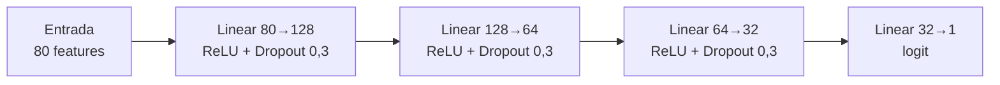
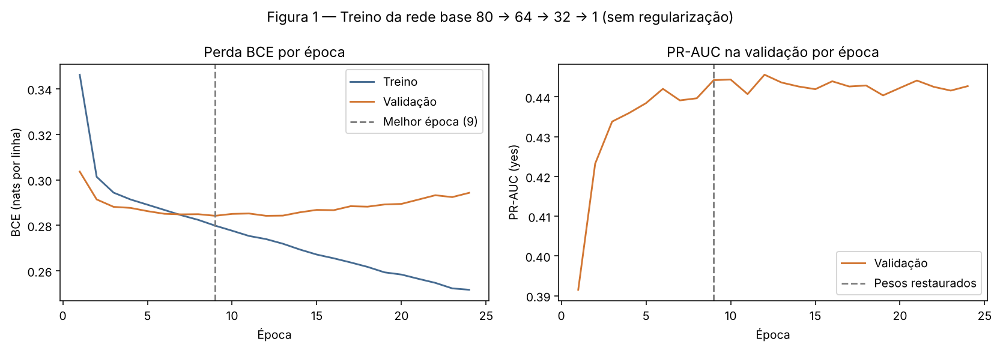
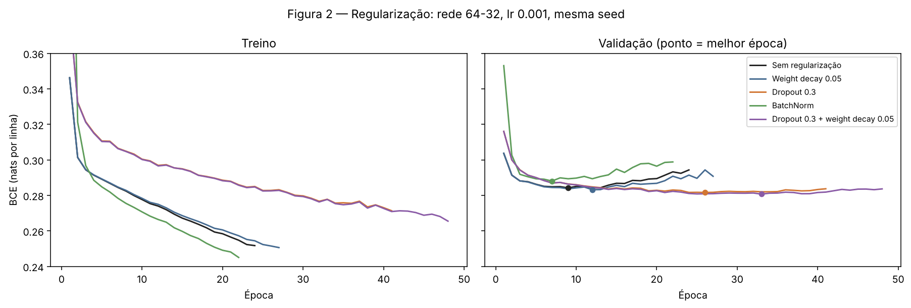
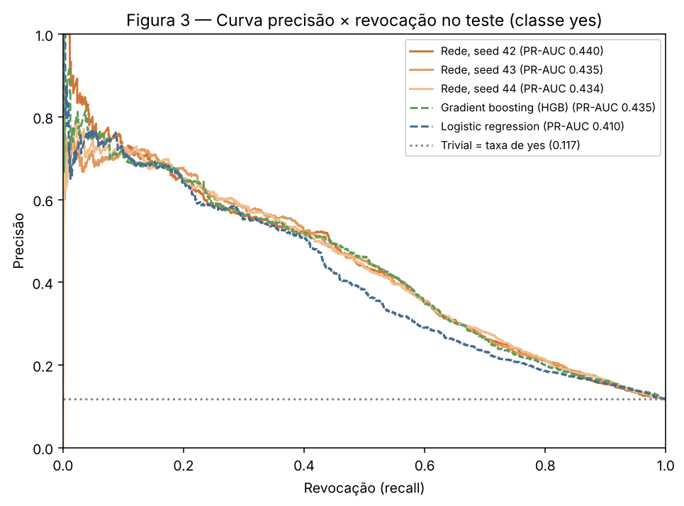
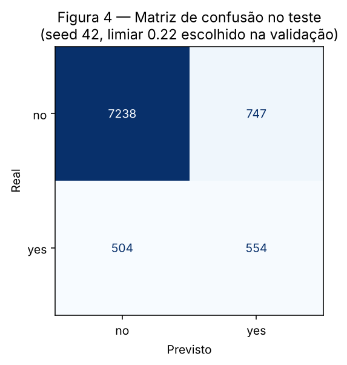
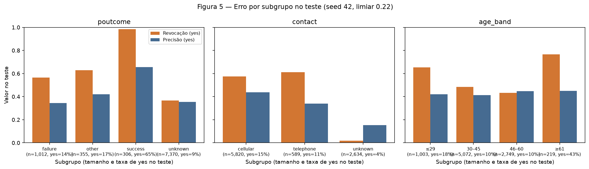
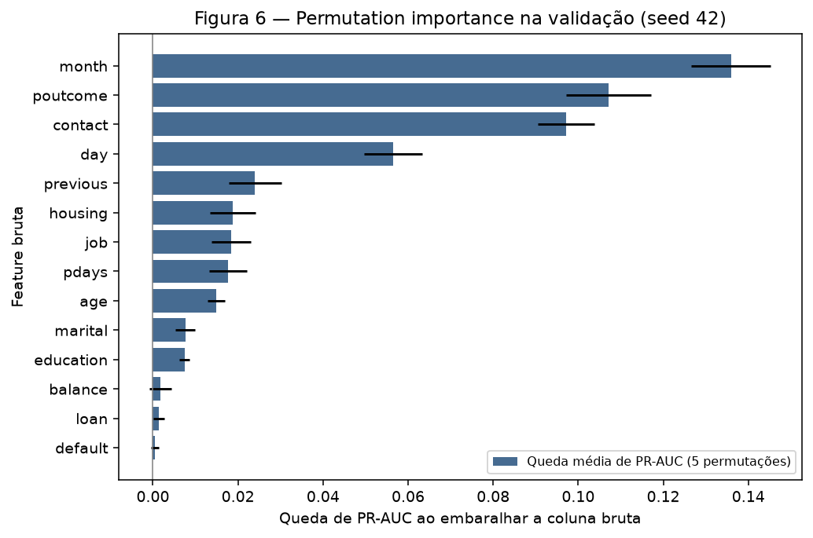

# 2. Classificação

!!! abstract "Entrega 2 de 3 do [Projeto](../index.md)"

    [Projects → Classification or Regression](https://insper.github.io/ann-dl/){:target='_blank'}

!!! info "Equipe"

    | Nome completo | GitHub |
    |---------------|--------|
    | Vitor Hideki Pereira Katakura | [@thevitorhideki](https://github.com/thevitorhideki) |
    | Antonio Anderson de Araujo Julião | [@andersonjuIiao](https://github.com/andersonjuIiao) |

    Dataset, decisões e status: [página do projeto](../index.md).

Nesta entrega treinamos uma rede neural para prever se um cliente do **UCI Bank Marketing**
contrata um depósito a prazo (`y = yes`), usando o mesmo dataset, a mesma tarefa e o mesmo
split do [EDA](../eda/index.ipynb). A pergunta que guia o relatório é a do enunciado: a rede
aprende algo que modelos mais simples não aprendem, e quanto podemos confiar no número que
ela reporta?

**Resposta curta:** a rede supera com folga a regressão logística (PR-AUC 0,436 contra 0,410
no teste), mas **empata com o gradient boosting** (0,435). O critério de sucesso que fixamos
antes de treinar não foi atingido. Os detalhes estão nas seções 5 e 7.

!!! note "Como reproduzir"

    A partir da raiz do repositório, instale `docs/projects/classification/code/requirements.txt`
    e rode os scripts **nesta ordem** (cada um salva seus resultados em `code/results/` e o
    seguinte lê o anterior):

    ```shell
    python -m pip install -r docs/projects/classification/code/requirements.txt
    python docs/projects/classification/code/step1_baselines.py
    python docs/projects/classification/code/step2_3_network.py
    python docs/projects/classification/code/step4_search.py      # cerca de 3 min em CPU
    python docs/projects/classification/code/step5_test.py        # avaliação final no teste
    python docs/projects/classification/code/step6_errors.py
    ```

    As dependências diretas estão fixadas nas versões usadas na conferência local
    (Python 3.14, CPU). Essa conferência reproduziu os baselines de validação e as previsões
    dos pesos salvos da seed 42, além de recalcular as médias e desvios das três seeds.
    Ela não repetiu a busca completa nem alterou a configuração escolhida. Pequenas diferenças
    numéricas entre plataformas podem ocorrer.

## 0. Starting point

**Pipeline do EDA.** Importamos `build_preprocessor()` de `../eda/code/preprocessing.py` sem
copiar nem alterar o código: sai `duration` (conhecida depois da ligação) e, conservadoramente,
`campaign` (inclui o contato atual),
o saldo recebe log com sinal, `previous` e os dias de `pdays` recebem `log1p`, o `-1` de
`pdays` vira o indicador `never_contacted`, as categóricas e `day` viram one-hot e as quatro
numéricas são padronizadas. São **80 features** (4 numéricas, o indicador e 75 colunas
one-hot), como no EDA. Até esta entrega não havíamos recebido apontamentos da correção do EDA,
então o pipeline foi reutilizado como estava.

**Mesmo split.** `common.make_splits()` repete a chamada do EDA (80/20, estratificado em `y`,
`random_state=42`) e confere o SHA-256 do CSV. A validação sai **de dentro do treino**: 15%,
também estratificada com a seed 42. O pipeline é ajustado (`fit`) só nos 30.742 registros de
treino e apenas aplicado (`transform`) à validação e ao teste.

| Conjunto | Registros | Taxa de `yes` |
|---|---|---|
| Treino | 30.742 | 11,70% |
| Validação | 5.426 | 11,70% |
| Teste (o mesmo do EDA) | 9.043 | 11,70% |

**Métrica principal e critério de sucesso, escritos antes de treinar** (constantes no início
de `common.py`):

- **Métrica principal: PR-AUC da classe `yes`** (average precision). Com 11,70% de positivos,
  a acurácia é dominada pela classe `no` (o trivial já tem 88,30%) e a ROC-AUC fica otimista
  porque os verdadeiros negativos são muitos. A PR-AUC só olha para o que importa ao banco:
  entre os clientes que a rede manda ligar, quantos contratam, e quantos contratantes ela acha.
  O trivial tem PR-AUC igual à taxa de positivos, 0,117.
- **Critério: PR-AUC média da rede no teste (3 seeds) pelo menos 5% maior que a do melhor
  baseline**, sendo o melhor baseline o escolhido **na validação**. Além disso, a diferença
  absoluta deve superar **um desvio padrão amostral da PR-AUC entre as três seeds**
  (`ddof=1`). As duas condições são verificadas por `common.assess_success()`; essa comparação
  descreve a variação do treino neste split, sem constituir um teste de significância.
- **Custo dos erros, para escolher o limiar:** uma ligação para quem não contrata (falso
  positivo) custa 1; deixar de ligar para quem contrataria (falso negativo) custa 5. O dataset
  não traz custos reais; a razão 1:5 é uma hipótese da equipe de que perder um depósito vale
  bem mais que alguns minutos de um operador. O limiar escolhido é o que minimiza, **na
  validação**, o custo médio por cliente:
  \( \text{custo} = (1 \cdot FP + 5 \cdot FN) / N \).

??? example "code/common.py: dados, split, rede, loop de treino e métricas"

    ```python
    --8<-- "docs/projects/classification/code/common.py"
    ```

## 1. Baselines

Os três baselines usam exatamente a mesma matriz de 80 features e foram avaliados **na
validação**. Para cada um, o limiar é o de menor custo na validação, como será feito com a rede.

| Baseline (validação) | PR-AUC | ROC-AUC | Limiar | F1 (`yes`) | Balanced acc. | Acurácia |
|---|---|---|---|---|---|---|
| Trivial (`DummyClassifier`, sempre `no`) | 0,1170 | 0,5000 | n/a | 0,0000 | 0,5000 | 0,8830 |
| Regressão logística (`C=1`) | 0,4189 | 0,7827 | 0,16 | 0,4414 | 0,7091 | 0,8410 |
| Gradient boosting (`HistGradientBoostingClassifier`) | **0,4580** | **0,8081** | 0,15 | **0,4827** | **0,7395** | 0,8511 |

O trivial confirma o EDA: 88,30% de acurácia sem achar nenhum contratante. A logística já
captura boa parte do sinal (PR-AUC 0,419, 3,6 vezes a do trivial). O boosting, que modela
interações entre features sem nenhum ajuste, fica 0,039 acima da logística. Ele é o
**melhor baseline na validação** e, pelo critério do passo 0, é contra ele que a rede será
comparada. Em dados tabulares é comum o boosting empatar com a rede, e o enunciado pede que
isso seja dito se acontecer.

??? example "code/step1_baselines.py"

    ```python
    --8<-- "docs/projects/classification/code/step1_baselines.py"
    ```

## 2. The network

A rede é uma MLP em PyTorch (`common.MLP`), escrita pela equipe. A **rede base** usada nas
seções 2 e 3 é 80 → 64 → 32 → 1; a **rede escolhida** na seção 4 é 80 → 128 → 64 → 32 → 1.



| | Escolha | Por quê |
|---|---|---|
| Camadas e larguras | Base 64-32; escolhida 128-64-32 | Larguras decrescentes vão comprimindo 80 features, 75 delas one-hot e esparsas, em uma representação pequena. A profundidade e a largura finais foram escolhidas na validação (seção 4), não a priori. |
| Ativação | ReLU | Não satura para entradas positivas, então o gradiente não some como na `tanh` em redes mais profundas, e custa pouco. |
| Inicialização | He (`kaiming_normal_`), bias zero | É a inicialização feita para ReLU: mantém a variância das ativações estável de camada em camada, evitando sinais que explodem ou morrem logo no início. |
| Saída | 1 unidade linear (**logit**) | Tarefa binária. A rede devolve o logit e a sigmoide só é aplicada quando precisamos de probabilidade (`predict_proba`). |
| Perda | `BCEWithLogitsLoss` | É a entropia cruzada binária com a sigmoide embutida, numericamente estável (evita `log(0)` quando a sigmoide satura). Corresponde a maximizar a verossimilhança de uma Bernoulli. |
| Desbalanceamento | Comparamos `pos_weight` = 7,55 (razão no/yes do treino) com perda sem ponderação; a escolhida usa `pos_weight=1` | A ponderação reduziu a PR-AUC de validação nas quatro arquiteturas (comparação na seção 4). A decisão final usa limiar por custo; isso é distinto de ponderar a perda. |

**Parâmetros × dados.** A rede base tem **7.297 parâmetros** para 30.742 linhas de treino
(4,2 linhas por parâmetro). A escolhida tem **20.737 parâmetros** (1,5 linha por parâmetro):
capacidade suficiente para decorar parte do treino, por isso ela só funciona junto com
dropout, weight decay e early stopping (seções 3 e 4).

## 3. Training

| Escolha | Valor | Por quê |
|---|---|---|
| Otimizador | AdamW | Adam adapta o passo de cada peso, o que ajuda com 75 colunas one-hot que aparecem com frequências muito diferentes. O "W" aplica o weight decay de forma desacoplada do gradiente, que é a forma correta de combinar Adam com L2. |
| Learning rate | 0,001 | Padrão do Adam. Na busca, 0,0003 convergiu mais devagar (melhor época 52 a 197) e terminou sempre com PR-AUC menor. |
| Batch | 256 | Cerca de 120 passos por época: gradiente pouco ruidoso e época de menos de 1 s em CPU. |
| Épocas | até 200, com early stopping | A parada é decidida pela perda de **validação**, com paciência de 15 épocas; os pesos da melhor época são **restaurados** ao final. |


/// caption
**Figura 1** — Rede base 64-32 sem regularização, seed 42: perda BCE de treino e de validação
(esquerda) e PR-AUC de validação (direita) por época.
///

**Leitura da Figura 1.** A rede base converge rápido: a perda de validação cai de 0,304 para
**0,284 na época 9**, a melhor. Daí em diante a perda de treino continua caindo (até 0,252 na
época 24), mas a de validação sobe, até 0,294 na época 24: é o início do **overfitting**, a rede
passa a aprender particularidades das 30.742 linhas de treino que não se repetem nas de
validação. Depois de 15 épocas sem melhorar, o treino parou na época 24 (5,8 s) e os pesos da
época 9 foram restaurados. A PR-AUC de validação fica num platô em torno de 0,44 a partir da
época 6, o que mostra que o ganho depois disso é pequeno mesmo antes do overfitting.

??? example "code/step2_3_network.py"

    ```python
    --8<-- "docs/projects/classification/code/step2_3_network.py"
    ```

## 4. Regularization and hyperparameters

### Técnicas de regularização

Mantivemos a rede base (64-32, lr 0,001, mesma seed e mesmo early stopping) e mudamos só a
regularização:

| Técnica (validação) | Melhor época | PR-AUC treino | PR-AUC validação | ROC-AUC validação | BCE validação |
|---|---|---|---|---|---|
| Sem regularização | 9 | 0,4832 | 0,4442 | 0,8035 | 0,2842 |
| Weight decay 0,05 | 12 | 0,5015 | 0,4476 | 0,8061 | 0,2831 |
| Dropout 0,3 | 26 | 0,5033 | 0,4574 | 0,8072 | 0,2816 |
| BatchNorm | 7 | 0,4813 | 0,4324 | 0,7972 | 0,2881 |
| **Dropout 0,3 + weight decay 0,05** | **33** | 0,5310 | **0,4636** | **0,8104** | **0,2807** |


/// caption
**Figura 2** — Perda de treino (esquerda) e de validação (direita) para cada técnica; o ponto
marca a melhor época de validação.
///

**Leitura.** Dropout e weight decay atacam o mesmo problema da Figura 1 por caminhos
diferentes. O **weight decay** puxa os pesos para zero a cada passo, o que suaviza a função
aprendida; sozinho, ajuda pouco (+0,003 de PR-AUC). O **dropout** desliga 30% dos neurônios
a cada passo, obrigando a rede a não depender de nenhum neurônio específico: a perda de
validação demora muito mais a subir (melhor época 26 em vez de 9) e a PR-AUC sobe 0,013. Os
dois **juntos** são o melhor: PR-AUC 0,4636, +0,019 sobre a rede sem regularização. O
**BatchNorm** piorou (0,4324) e acelerou o overfitting (melhor época 7); com batches de 256
linhas e entradas majoritariamente binárias, ele normaliza estatísticas ruidosas e não
funciona como regularizador aqui.

Dois cuidados de leitura. Primeiro, a curva de treino com dropout fica **acima** das outras
porque a perda de treino é medida com o dropout ligado; isso não significa ajuste pior. Segundo,
a PR-AUC de treino das redes regularizadas é **maior** que a da rede sem regularização: elas
treinam por mais épocas antes da parada, então tanto treino quanto validação melhoram. O que
importa é a validação.

### Busca de hiperparâmetros

Buscamos **16 configurações**: 4 arquiteturas (32; 64-32; 128-64; 128-64-32) × {lr 0,001 e
0,0003 com dropout 0,3 e weight decay 0,05; regularização leve (dropout 0,1, weight decay
0,01); `pos_weight` 7,55}. Todas foram escolhidas **pela PR-AUC de validação**, com seed 42.
A regra de escolha (maior PR-AUC de validação; em empate, menos parâmetros) foi fixada no
código antes de rodar a busca.

| # | Configuração | Parâmetros | Melhor época | PR-AUC treino | **PR-AUC validação** | ROC-AUC validação |
|---|---|---|---|---|---|---|
| 1 | **128-64-32, lr 0,001, dropout 0,3, wd 0,05** | 20.737 | 28 | 0,5571 | **0,4666** | 0,8061 |
| 2 | 128-64, lr 0,001, dropout 0,3, wd 0,05 | 18.689 | 24 | 0,5403 | 0,4659 | 0,8078 |
| 3 | 64-32, lr 0,001, dropout 0,3, wd 0,05 | 7.297 | 33 | 0,5310 | 0,4636 | 0,8104 |
| 4 | 128-64-32, lr 0,001, dropout 0,1, wd 0,01 | 20.737 | 8 | 0,4948 | 0,4606 | 0,7996 |
| 5 | 128-64-32, lr 0,0003, dropout 0,3, wd 0,05 | 20.737 | 56 | 0,5097 | 0,4599 | 0,8033 |
| 6 | 128-64, lr 0,0003, dropout 0,3, wd 0,05 | 18.689 | 52 | 0,5129 | 0,4583 | 0,8064 |
| 7 | 64-32, lr 0,0003, dropout 0,3, wd 0,05 | 7.297 | 82 | 0,5072 | 0,4568 | 0,8085 |
| 8 | 128-64, lr 0,001, dropout 0,1, wd 0,01 | 18.689 | 9 | 0,5031 | 0,4546 | 0,8038 |
| 9 | 32, lr 0,001, dropout 0,3, wd 0,05 | 2.625 | 100 | 0,5271 | 0,4521 | 0,8078 |
| 10 | 32, lr 0,0003, dropout 0,3, wd 0,05 | 2.625 | 197 | 0,5050 | 0,4507 | 0,8062 |
| 11 | 32, lr 0,001, dropout 0,1, wd 0,01 | 2.625 | 50 | 0,5178 | 0,4501 | 0,8023 |
| 12 | 32, lr 0,001, dropout 0,3, wd 0,05, `pos_weight` | 2.625 | 81 | 0,4960 | 0,4495 | 0,8050 |
| 13 | 64-32, lr 0,001, dropout 0,1, wd 0,01 | 7.297 | 13 | 0,4819 | 0,4493 | 0,8050 |
| 14 | 128-64-32, lr 0,001, dropout 0,3, wd 0,05, `pos_weight` | 20.737 | 13 | 0,4638 | 0,4487 | 0,8078 |
| 15 | 128-64, lr 0,001, dropout 0,3, wd 0,05, `pos_weight` | 18.689 | 16 | 0,4887 | 0,4482 | 0,8043 |
| 16 | 64-32, lr 0,001, dropout 0,3, wd 0,05, `pos_weight` | 7.297 | 16 | 0,4591 | 0,4469 | 0,8047 |

**O que a busca mostra.**

- **Regularização forte vence regularização leve** nas quatro arquiteturas (por exemplo,
  128-64-32: 0,4666 contra 0,4606), repetindo a conclusão da Figura 2.
- **lr 0,001 vence 0,0003** nas quatro arquiteturas: com o passo menor e a mesma paciência, o
  treino demora 2 a 3 vezes mais e para antes de chegar ao mesmo ponto.
- **`pos_weight` reduz a PR-AUC de validação nas quatro comparações** (−0,003 a −0,018).
  As redes maiores atingem a melhor perda ponderada nas épocas 13 a 16, contra 24 a 33 sem
  ponderação. Os limiares escolhidos também sobem de 0,14–0,22 para 0,57–0,64. A ponderação
  altera o objetivo do treino e pode alterar tanto a ordenação quanto a escala dos escores;
  ajustar o limiar depois não garante recuperar a mesma ordenação.
- **Profundidade ajuda pouco.** As três primeiras configurações estão separadas por **0,003**,
  menos que a variação entre seeds medida na seção 5 (desvio de 0,004 na PR-AUC de validação).
  Pela regra fixada antes da busca, a escolhida é a **128-64-32**, mas, na prática, as redes de
  duas e três camadas ocultas com a mesma regularização empatam.

### Tratamento do desbalanceamento

Com dropout 0,3, weight decay 0,05, lr 0,001 e seed 42, isolamos a mudança de peso na perda.
O valor 7,55 é a razão entre negativos e positivos **somente no treino**, arredondada a duas
casas; nenhuma reamostragem foi aplicada à validação ou ao teste.

| Arquitetura | PR-AUC validação sem ponderação | PR-AUC validação com `pos_weight=7,55` | Diferença ponderada − sem ponderação |
|---|---|---|---|
| 32 | 0,4521 | 0,4495 | −0,0026 |
| 64-32 | 0,4636 | 0,4469 | −0,0167 |
| 128-64 | 0,4659 | 0,4482 | −0,0176 |
| 128-64-32 | 0,4666 | 0,4487 | −0,0180 |

**Decisão pela validação.** A ponderação foi implementada e avaliada como tratamento do
desbalanceamento, mas nenhuma das quatro configurações ponderadas venceu sua comparação
sem ponderação pela métrica principal. Por isso, mantivemos a vencedora da busca sem peso
adicional na perda. São resultados de uma seed por configuração, não evidência de que
ponderar classes seja sempre pior.

!!! warning "Limite de aderência ao enunciado"

    O enunciado pede ponderação da perda ou reamostragem. O experimento com `pos_weight`
    cobre essa comparação, mas a rede final não usa nenhuma das duas técnicas. O limiar por
    custo não substitui esse requisito literalmente. Registramos essa limitação e mantemos a
    seleção original por validação; não escolhemos outro modelo depois de observar o teste.

??? example "code/step4_search.py"

    ```python
    --8<-- "docs/projects/classification/code/step4_search.py"
    ```

## 5. Test evaluation

A configuração escolhida (128-64-32, dropout 0,3, weight decay 0,05, AdamW lr 0,001, batch 256)
foi **retreinada com três seeds** (42, 43 e 44). Em cada seed, a melhor época e o limiar de
custo foram decididos **na validação** e congelados; só então o modelo foi aplicado ao teste.
Na execução original, a avaliação final foi feita em `step5_test.py`, depois de todas as
decisões. Os baselines da seção 1 foram avaliados no mesmo teste, na mesma execução. A análise
de erros e a conferência posterior dos pesos e previsões salvos não fizeram novas escolhas
de arquitetura, hiperparâmetros ou limiar.

### A rede nas três seeds

| Seed | Melhor época (parou em) | Limiar (validação) | PR-AUC | ROC-AUC | Precisão `yes` | Revocação `yes` | F1 `yes` |
|---|---|---|---|---|---|---|---|
| 42 | 28 (43) | 0,22 | 0,4398 | 0,7890 | 0,4258 | 0,5236 | 0,4697 |
| 43 | 19 (34) | 0,20 | 0,4345 | 0,7934 | 0,4085 | 0,5444 | 0,4668 |
| 44 | 16 (31) | 0,17 | 0,4342 | 0,7942 | 0,3946 | 0,5577 | 0,4622 |
| **Média ± desvio** | | | **0,4362 ± 0,0032** | 0,7922 ± 0,0028 | 0,4097 ± 0,0156 | 0,5419 ± 0,0172 | 0,4662 ± 0,0038 |

Os limiares de 0,17 a 0,22 estão próximos de 1/(1+5) ≈ 0,17, o limiar que minimiza o custo
1:5 quando as probabilidades são bem calibradas. Essa proximidade, sozinha, não demonstra
calibração; não medimos uma curva de calibração nesta entrega.

### Rede e baselines no mesmo teste

| Modelo (teste) | PR-AUC | ROC-AUC | Precisão `yes` | Revocação `yes` | F1 `yes` | F1 macro | Balanced acc. | Acurácia | Custo médio |
|---|---|---|---|---|---|---|---|---|---|
| Trivial (sempre `no`) | 0,1170 | 0,5000 | 0,0000 | 0,0000 | 0,0000 | 0,4689 | 0,5000 | 0,8830 | 0,585 |
| Regressão logística | 0,4098 | 0,7713 | 0,3689 | 0,5066 | 0,4269 | 0,6673 | 0,6959 | 0,8409 | 0,390 |
| Gradient boosting (HGB) | 0,4352 | 0,7912 | 0,3968 | 0,5690 | 0,4676 | 0,6896 | 0,7272 | 0,8484 | **0,353** |
| **Rede (média de 3 seeds)** | **0,4362** | **0,7922** | **0,4097** | 0,5419 | 0,4662 | **0,6911** | 0,7191 | 0,8548 | 0,360 |


/// caption
**Figura 3** — Curva precisão × revocação da classe `yes` no teste: rede nas três seeds,
boosting, logística e a linha do trivial.
///

**O critério do passo 0 foi atingido? Não.** O melhor baseline na validação foi o boosting;
sua PR-AUC no teste é 0,4352, então a meta era 1,05 × 0,4352 = **0,4570**. A rede chegou a
**0,4362**, um ganho de apenas **+0,22%**, e a diferença para o boosting (0,0010) é **menor que
o desvio entre seeds** (0,0032). Rede e boosting empatam: as curvas da Figura 3 praticamente se
sobrepõem, e o boosting tem até um custo médio um pouco menor (0,353 contra 0,360) por operar
num limiar de revocação mais alta.

**Contra a logística, a rede ganha de verdade:** +0,026 de PR-AUC (**+6,4%**), cerca de 8
desvios entre seeds, e a curva da rede fica acima da logística em quase toda a faixa de
revocação entre 0,3 e 0,7 (Figura 3). Esse é o ganho que vem da camada oculta: a rede (como o
boosting) combina features de forma não linear, por exemplo histórico de campanha e mês.

**Treino, validação e teste (seed 42, limiar 0,22)**

| Métrica | Treino | Validação | Teste |
|---|---|---|---|
| PR-AUC | 0,5571 | 0,4666 | 0,4398 |
| ROC-AUC | 0,8736 | 0,8061 | 0,7890 |
| Acurácia | 0,8789 | 0,8682 | 0,8617 |
| Precisão `yes` | 0,4862 | 0,4502 | 0,4258 |
| Revocação `yes` | 0,6157 | 0,5701 | 0,5236 |
| F1 `yes` | 0,5433 | 0,5031 | 0,4697 |

A queda de 0,557 (treino) para 0,467 (validação) é o overfitting que restou mesmo com
regularização. A queda de 0,467 para 0,440 entre validação e teste tem duas causas: a validação
foi usada para **escolher** entre 16 configurações, o que a torna otimista para a escolhida, e
o teste é uma amostra diferente. Os baselines, que não passaram por busca, também caem (boosting
0,458 → 0,435, logística 0,419 → 0,410): parte da queda é da amostra, não só da seleção.


/// caption
**Figura 4** — Matriz de confusão no teste, seed 42, limiar 0,22 escolhido na validação.
///

**Leitura da Figura 4.** Dos 1.058 contratantes do teste, a rede indica **554** (revocação
0,524) e perde **504**. Para isso, manda ligar para 1.301 clientes, dos quais **747** não
contratam (precisão 0,426). Por classe: `no` tem precisão 0,935, revocação 0,906 e F1 0,921;
`yes` tem 0,426, 0,524 e 0,470; o F1 macro é 0,695. Em termos do negócio, ligar só para os
1.301 indicados (14% da base) acha metade dos contratantes; ligar para todos acharia todos, mas
com 9.043 ligações. O erro mais caro no nosso modelo de custo são os 504 falsos negativos (custo
2.520, contra 747 dos falsos positivos).

??? example "code/step5_test.py"

    ```python
    --8<-- "docs/projects/classification/code/step5_test.py"
    ```

## 6. Error analysis

A análise usa as previsões de teste **já salvas** pelo passo 5 (seed 42, limiar 0,22); nada é
retreinado e nenhuma decisão é tomada a partir destes números.

### Erro por subgrupo

| Subgrupo (teste) | n | Taxa de `yes` | Taxa de erro | Revocação `yes` | Precisão `yes` | PR-AUC |
|---|---|---|---|---|---|---|
| `poutcome` = success | 306 | 65,0% | 34,6% | 0,985 | 0,656 | 0,768 |
| `poutcome` = failure | 1.012 | 13,8% | 20,8% | 0,564 | 0,345 | 0,354 |
| `poutcome` = other | 355 | 17,5% | 21,7% | 0,629 | 0,419 | 0,379 |
| `poutcome` = unknown | 7.370 | 8,9% | 11,6% | 0,365 | 0,353 | 0,285 |
| `contact` = cellular | 5.820 | 15,3% | 17,7% | 0,575 | 0,438 | 0,475 |
| `contact` = telephone | 589 | 11,4% | 18,0% | 0,612 | 0,339 | 0,454 |
| **`contact` = unknown** | **2.634** | **3,9%** | 4,3% | **0,019** | 0,154 | **0,070** |
| idade ≤ 29 | 1.003 | 17,8% | 22,3% | 0,654 | 0,419 | 0,505 |
| idade 30–45 | 5.072 | 9,9% | 11,9% | 0,484 | 0,412 | 0,394 |
| idade 46–60 | 2.749 | 10,4% | 11,4% | 0,432 | 0,447 | 0,428 |
| idade ≥ 61 | 219 | 42,9% | 50,2% | 0,766 | 0,450 | 0,579 |
| `month` = dec | 36 | 44,4% | **55,6%** | 1,000 | 0,444 | 0,538 |
| `month` = oct | 146 | 43,8% | 54,1% | 0,922 | 0,444 | 0,681 |

A tabela mostra todos os grupos de histórico, canal e idade, além dos dois meses com maior
taxa de erro. Os 12 meses estão no [CSV completo](code/results/step6_subgroups.csv).
Aqui, **taxa de erro = (FP + FN) / n**; o pior recall é outra medida e aparece separadamente.


/// caption
**Figura 5** — Revocação e precisão da classe `yes` no teste por histórico de campanha
(`poutcome`), canal (`contact`) e faixa de idade, com o tamanho e a taxa de `yes` de cada grupo.
///

Os padrões, cada um com uma hipótese:

1. **`contact` = unknown é o ponto cego.** A rede acha **2 dos 103** contratantes desse grupo
   (revocação 0,019), e a PR-AUC dentro dele é 0,070, pouco acima da taxa de `yes` do próprio
   grupo (0,039): dentro desse grupo, a rede quase não sabe ordenar quem contrata. A taxa de erro
   baixa (4,3%) engana: ela vem de prever `no` para quase todos num grupo com 96% de `no`.
   *Hipótese:* no Bank Marketing, o canal desconhecido se concentra num período inicial da
   campanha, com adesão baixa; a rede aprendeu "unknown ⇒ não ligar", e os poucos contratantes
   do grupo não têm nenhuma outra característica (histórico, mês) que os destaque.
2. **`poutcome` = success é quase todo marcado como `yes`** (revocação 0,985, precisão 0,656).
   O EDA já tinha mostrado 64,65% de adesão nesse histórico no treino; a rede faz exatamente
   isso, e os **5 piores falsos positivos** (probabilidade de 0,82 a 0,85) são todos clientes
   com `poutcome` = success e canal celular, contatados em mar, dec, jan e sep. *Hipótese:* um
   sucesso anterior é o sinal mais forte disponível antes da ligação, mas um terço desses
   clientes não repete a contratação, e nada no arquivo diferencia os que repetem.
3. **`poutcome` = unknown concentra o volume de erro.** São 81% do teste, com revocação 0,365:
   **417 dos 504 falsos negativos** vêm desse grupo de clientes nunca contatados. Entre os **5
   piores falsos negativos** (probabilidade de 0,003 a 0,005), quatro nunca foram contatados antes,
   e todos têm saldo entre −462 e 1.238 euros e contato em jan, feb, jun ou aug. *Hipótese:* sem
   histórico, sobra pouca informação anterior à ligação, e a rede não tem como distinguir esses
   contratantes da massa de clientes que não contrata.
4. **A rede recupera mais positivos nos extremos de idade.** Abaixo de 30 e acima de 60 anos a taxa de `yes` é
   maior (17,8% e 42,9%) e a revocação também (0,654 e 0,766). Entre 30 e 60 anos, onde está a
   maior parte da base, a revocação cai para 0,43 a 0,48. O grupo ≥ 61 tem a maior taxa de erro
   **entre as faixas de idade** (50,2%): são 88 falsos positivos e 22 falsos negativos em 219
   clientes. *Hipótese:* a alta adesão nesse grupo faz a rede indicar muitas ligações, elevando
   o recall e também os falsos positivos. Recall maior, sozinho, não significa menor erro.
5. **Dezembro tem a maior taxa de erro entre todos os subgrupos calculados:** **55,6%
   (20/36)**, seguido de outubro, 54,1% (79/146). Em dezembro, a rede indica todos os 36 clientes:
   encontra os 16 contratantes e erra os 20 que não contratam. *Hipótese:* o modelo usa a alta
   adesão histórica desses meses como sinal para ligar, com pouca discriminação dentro do mês.
   O grupo de dezembro é pequeno; cada erro muda sua taxa em 2,8 pontos percentuais, então esse
   resultado é descritivo deste teste e não sustenta uma conclusão estável sobre outros anos.

### Permutation importance

Embaralhamos cada coluna **bruta** (antes do pipeline, para que todas as colunas one-hot de uma
categórica mudem juntas) na **validação**, 5 vezes, e medimos a queda da PR-AUC da rede da seed
42 (PR-AUC de validação sem embaralhar: 0,4666).


/// caption
**Figura 6** — Queda média de PR-AUC na validação ao embaralhar cada feature bruta (barra de
erro: desvio entre as 5 repetições).
///

| Feature | Queda de PR-AUC | | Feature | Queda de PR-AUC |
|---|---|---|---|---|
| `month` | 0,136 ± 0,009 | | `pdays` | 0,018 ± 0,004 |
| `poutcome` | 0,107 ± 0,010 | | `age` | 0,015 ± 0,002 |
| `contact` | 0,097 ± 0,007 | | `marital` | 0,008 ± 0,002 |
| `day` | 0,057 ± 0,007 | | `education` | 0,007 ± 0,001 |
| `previous` | 0,024 ± 0,006 | | `balance` | 0,002 ± 0,003 |
| `housing` | 0,019 ± 0,005 | | `loan` | 0,001 ± 0,001 |
| `job` | 0,018 ± 0,005 | | `default` | 0,001 ± 0,001 |

**Bate com o EDA?** Em parte.

- **Bate:** `poutcome` é a segunda feature mais importante, como a Figura 6 do EDA sugeria
  (64,65% de adesão em success contra 9,22% em unknown). `job` e `age` têm algum efeito, como as
  diferenças de taxa por profissão e de dispersão de idade vistas no EDA.
- **Não bate:** o EDA mostrou mediana de saldo de 740 euros entre os `yes` contra 419 entre os
  `no`, mas `balance` quase não importa para a rede (0,002, dentro do ruído). As distribuições se
  sobrepõem muito, e o que o saldo diz sobre o cliente provavelmente já está em idade, profissão
  e financiamento imobiliário (`housing`).
- **O ponto mais importante:** as três features de **calendário e canal** (`month`, `contact` e
  `day`) somam a maior parte da importância, com `month` em primeiro lugar. O EDA tinha deixado
  como **hipótese a confirmar** que dia, mês e canal planejados são conhecidos antes da ligação.
  A rede depende tanto delas que, se essa hipótese não valer, o desempenho cai muito: só
  embaralhar `month` derruba a PR-AUC de validação de 0,467 para cerca de 0,33. Além disso, o
  arquivo não tem o ano e está ordenado por data; meses com poucas ligações e adesão alta (mar,
  sep, oct, dec, todos com 44% a 57% de `yes` no teste) podem estar marcando **um período** da
  campanha, não uma sazonalidade que se repita.

??? example "code/step6_errors.py"

    ```python
    --8<-- "docs/projects/classification/code/step6_errors.py"
    ```

## 7. Conclusion

**A rede valeu a pena?** Contra um modelo linear, sim: +6,4% de PR-AUC no teste, uma diferença
8 vezes maior que a variação entre seeds, que vem das interações não lineares. Contra o gradient
boosting, não: os dois empatam (0,4362 ± 0,0032 contra 0,4352), e o boosting sai praticamente
pronto, sem busca de hiperparâmetros, em segundos. O critério que fixamos antes de treinar
(+5% sobre o melhor baseline) **não foi atingido**. Para estes dados, a rede é uma alternativa
equivalente ao boosting, não uma melhoria.

**Limitações.**

- **Split aleatório.** Sem ano e sem ID de cliente, o split não mede o desempenho em campanhas
  futuras nem garante clientes diferentes entre treino e teste (limitação já apontada no EDA).
- **Dependência do calendário.** `month`, `contact` e `day` são as features mais importantes, e
  a disponibilidade delas antes da ligação continua sendo uma hipótese não confirmada.
- **Custo assumido.** A razão 1:5 entre os erros é uma hipótese da equipe; com outra razão, o
  limiar e a precisão/revocação mudam (a PR-AUC, não).
- **Seleção na validação.** Uma única divisão de validação, com diferenças entre as melhores
  configurações menores que o ruído entre seeds.
- **Ponderação rejeitada na validação.** O tratamento por `pos_weight` foi comparado, mas não
  ficou na rede final. Isso limita a aderência literal ao requisito de desbalanceamento,
  conforme a seção 4.

**Quem seria afetado por um erro.** Um falso positivo é um cliente que recebe uma ligação que
não queria; um falso negativo é um cliente que não recebe uma oferta que aceitaria. A rede
quase nunca indica clientes com canal desconhecido (revocação 1,9%) e indica quase todos com
sucesso anterior, então concentra as ligações nos mesmos clientes já contatados. Como a idade é
uma feature, a política resultante também trata faixas etárias de forma diferente (revocação de
0,77 acima de 60 anos contra 0,43 entre 46 e 60); qualquer uso real precisaria verificar se isso
é aceitável e conforme às regras de não discriminação.

**Com mais tempo**, faríamos: (1) um split **temporal**, reconstruindo o ano a partir da ordem
do arquivo; (2) a mesma análise **sem** `month`, `day` e `contact`, para medir quanto do
desempenho depende da hipótese de calendário; (3) validação cruzada estratificada na escolha de
hiperparâmetros, para reduzir o ruído da seleção; (4) calibração das probabilidades e uma curva
de custo para várias razões FP:FN; (5) um ensemble rede + boosting.

**Bônus de competição:** não se aplica; o Bank Marketing vem do UCI, não de uma competição aberta.

## Results summary

| # | Summary | Value |
|---|---|---|
| 1 | Dataset, task, target and main metric | UCI Bank Marketing (`bank-full.csv`); classificação binária; alvo `y` = `yes` (11,70%); métrica principal: PR-AUC da classe `yes` |
| 2 | Train · validation · test (rows) | 30.742 · 5.426 · 9.043 |
| 3 | Best baseline and its test metric | Gradient boosting (`HistGradientBoostingClassifier`), escolhido na validação: PR-AUC 0,4352 no teste (regressão logística: 0,4098) |
| 4 | Chosen network: layers × units, number of parameters, regularization | 3 camadas ocultas 128 × 64 × 32 (ReLU), saída de 1 logit; 20.737 parâmetros; dropout 0,3 + weight decay 0,05 + early stopping |
| 5 | Optimizer, learning rate, batch and the epoch it stopped at | AdamW, lr 0,001, batch 256; seed 42 parou na época 43 com pesos restaurados da época 28 (seeds 43 e 44: épocas 19 e 16, paradas em 34 e 31) |
| 6 | The network's main metric on the test set (mean ± std, 3 seeds) | PR-AUC 0,4362 ± 0,0032 (ROC-AUC 0,7922 ± 0,0028; F1 `yes` 0,4662 ± 0,0038) |
| 7 | Success criterion met? | **Não.** Meta ≥ 0,4570 (1,05 × 0,4352); ganho de +0,22% sobre o boosting, menor que o desvio entre seeds. Supera a regressão logística em +6,4% |
| 8 | Subgroup with the largest error and its value | `month` = dec: taxa de erro 55,6% (20/36; amostra pequena). Separadamente, o pior recall de `yes` é `contact` = unknown: 0,019 (2/103) |
